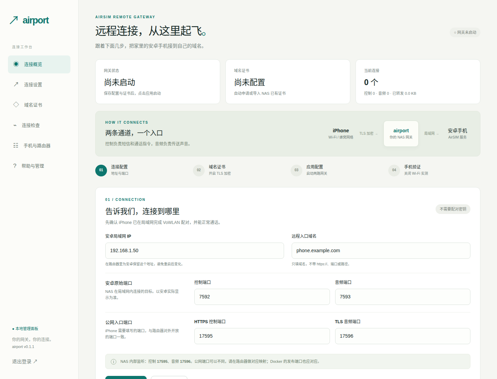

# airport

**让家里的电话，随你一起出发。**

airport 是面向 AirSIM 安卓端的自建 NAS TLS 网关，提供中文设置面板。它把公网的 HTTPS 控制、TLS 音频两条连接转发到同一台安卓的局域网接口，保留原来的 AirSIM 配对和鉴权协议。

- 中文引导：局域网地址、公网域名、两组端口分别填写，错误定位到具体输入框。
- 两路原始 TCP TLS 转发：控制和 PCM 都能通过，不需要另配网页反向代理。
- 证书导入、NAS 证书挂载热更新，以及 Cloudflare / 阿里云 DNS / DNSPod 自动申请续期。
- 域名、证书、控制接口、音频端口诊断；明确区分端口连通、设备身份和真实音频。
- 手机填写信息、路由器映射表、运行状态、最近事件、无密钥配置导出。
- 首次访问直接设置管理密码，以后使用密码登录；管理面板仅接受内网访问。
- Docker Compose 部署，支持 x86_64 和 ARM64 NAS。



## 适用范围

需要 **支持“自建域名直连”的 AirSIM iOS 客户端**，例如包含 [AirSIM PR #11](https://github.com/kai-wu-cortex/AirSIM/pull/11) 改动的构建。该 PR 当前不能视为已经并入上游；普通上游客户端是否包含此入口，需要检查实际版本。

先在局域网完成 iPhone 与安卓的 **VoWLAN 配对**，并确认本地短信和双向通话正常。airport 不代替配对，不保存配对密钥，不更改安卓协议，也不新增后台来电推送。当前面板管理 **一台安卓、一个域名**；多台设备可运行独立实例并分配不同端口。

```text
外网 iPhone
  ├─ phone.example.com:17595 ─ TLS ─ NAS airport ─ TCP ─ 安卓:7592
  └─ phone.example.com:17596 ─ TLS ─ NAS airport ─ TCP ─ 安卓:7593
```

需要可入站公网 IPv4，或 NAS 可用的公网 IPv6。**仅有 CGNAT IPv4 和 DDNS 无法提供公网入站。** 如果入口只有 IPv6，手机网络也必须支持 IPv6。

## 快速开始

### 方式一：引导安装

适用于已安装 Docker Compose 的 Linux NAS。脚本会询问 NAS 内网 IP 和网络方式，不修改路由器、防火墙及已有服务；已有安装目录会拒绝覆盖。

```sh
curl -fL https://raw.githubusercontent.com/chainfix/airport/v0.1.1/scripts/install.sh -o install-airport.sh
sh install-airport.sh
```

无人值守安装可设置 `AIRPORT_NAS_IP=192.168.1.20`、`AIRPORT_NETWORK_MODE=bridge` 或 `host`，以及可选的 `AIRPORT_INSTALL_DIR`。镜像下载失败时会尝试本地构建。安装完成后打开 `http://NAS局域网IP:8787`，页面会直接提示设置至少 12 字符的管理密码，无需初始化码或查看日志。

### 方式二：NAS 图形化部署

以群晖 Container Manager「项目」、威联通 Container Station「应用程序」为例：

1. 下载本仓库源码到 NAS 的一个新目录。
2. 将 `.env.example` 复制为 `.env`，把 `AIRPORT_PANEL_BIND` 改为 **NAS 的局域网 IPv4 地址**。
3. 导入 `compose.yaml` 并启动。不要直接保留示例 IP，也不要将管理端口绑定到公网地址。
4. 打开 `http://NAS局域网IP:8787`，直接设置管理密码并进入面板。

普通 `compose.yaml` 使用桥接网络，适合公网 IPv4 端口映射。**IPv6 建议 Linux NAS 使用 `compose.host.yaml`**，让 TLS 网关监听 `::` 双栈地址；面板仍绑定指定内网 IPv4。不要假设 Docker 默认桥接网络已经支持入站 IPv6。

### 方式三：命令行部署

```sh
git clone https://github.com/chainfix/airport.git
cd airport
cp .env.example .env
# 编辑 .env，填写 NAS 的真实局域网 IPv4
docker compose up -d
# 若要从源码构建：docker compose up -d --build
# Linux NAS IPv6 模式：docker compose -f compose.host.yaml up -d
docker compose logs airport
```

如果 `ghcr.io` 无法访问，可以从源码构建；Docker Hub / Python 软件源仍需可访问。

## 面板中的四步设置

### 1. 填写连接信息

| 字段 | 示例 | 含义 |
|---|---|---|
| 安卓局域网 IP | `192.168.1.50` | 安卓当前的局域网地址，建议做 DHCP 保留 |
| 域名 | `phone.example.com` | 不带协议、端口或路径 |
| 安卓控制 / 音频端口 | `7592` / `7593` | 以安卓实际监听为准，重启后端口可能改变 |
| 公网控制 / 音频端口 | `17595` / `17596` | 手机要填写的两个公网端口 |

公网端口与 NAS 端口可以不同。面板中的“公网端口”仅用于生成手机配置和公网诊断，**不会自动修改 Docker 或路由器映射**。NAS 默认监听 `17595/17596`。保存之后，需要点击“应用并启动”才会改变运行配置；重启仍加载最后一次应用的配置，不会把未应用草稿直接上线。

面板拒绝公网、回环和链路本地后端地址，后端使用明确的私网 IP，不对任意网址提供通用转发服务。

### 2. 准备证书

三种方式选一种：

**导入已有证书**：选择与域名匹配的 `fullchain.pem` 和未加密 `privkey.pem`。会检查 PEM 格式、域名、有效期、私钥匹配、服务端用途和系统信任链；错误时保留原证书。手动上传不会自动续期。

**自动申请与续期**：选择 DNS 服务商并填写邮箱、凭据，同意 Let's Encrypt 服务条款，保存设置后申请。

| 服务商 | 凭据 | 说明 |
|---|---|---|
| Cloudflare | DNS API Token | 授予对应区域的 DNS Edit 与 Zone Read；域名记录使用“仅 DNS” |
| 阿里云 DNS | AccessKey ID、AccessKey Secret | 建议使用有该域名 DNS 管理权限的 RAM 子账号 |
| 腾讯云 DNSPod | SecretId、SecretKey | 建议使用具备对应域名解析管理权限的子账号 |
| DNSPod 旧版 | `ID,Token` | 保留兼容旧个人令牌；新用户建议选择腾讯云 DNSPod |

使用 lego 的 DNS-01 验证，不需要开放 80 端口。域名的权威 DNS 必须在所选服务商托管，凭据必须能够操作其验证记录。成功后每 12 小时检查一次，剩余不足 30 天自动续期。DNS 凭据只写入权限为 `0600` 的本地数据文件，不返回浏览器，也不写入应用事件；整个数据卷的备份仍包含敏感信息，需要妥善保管。

**NAS 挂载证书**：在 Compose 的 volumes 中添加：

```yaml
- /实际/NAS/证书目录:/certs:ro
```

目录内应有 `fullchain.pem` 和 `privkey.pem`，容器 UID `10001` 要有读取权限。若 NAS 文件名不同，可在独立目录准备这两个标准文件并由 NAS 续期任务更新。不要直接挂载整套 NAS 配置目录。点击“验证并加载挂载证书”后，每分钟检查内容变化；新证书验证通过才替换，已有连接继续使用原会话。

### 3. 启动与配置路由器

点击“应用并启动”。端口被占用、证书缺失或域名不匹配会给出提示。

公网 IPv4 例子：

| 公网 TCP 端口 | NAS 目标 |
|---|---|
| `17595` | `192.168.1.20:17595` |
| `17596` | `192.168.1.20:17596` |

- DDNS 的 A 记录指向路由器公网 IPv4。
- IPv6 的 AAAA 记录指向 NAS 的公网 IPv6，并放行路由器和 NAS 防火墙。
- 同时发布 A / AAAA 时，两条入站路径都要有效。
- NAS → 安卓这一段必须以 NAS 或允许的私网出口地址连接，不使用 PROXY protocol 或透明保留公网源 IP。
- **不要公开 8787 管理端口、配对端口、安卓明文控制和音频端口。**

### 4. 手机完成验证

在 AirSIM「设置 → 三星连接 → 自建域名直连」选择已配对安卓，填写面板显示的域名和两个公网端口，点击“验证并保存”。选择 VoWLAN、自动或本地双通道模式，然后关闭 Wi-Fi，测试短信、拨号和双向声音。

现有客户端没有 airport 扫码导入协议，因此首版提供复制填写信息，不把普通二维码宣称为可自动配对。远程入口成功不代表 Watch、锁屏来电、后台推送已通过验证。

## 诊断怎么看

| 提示 | 含义与下一步 |
|---|---|
| 网页账号密码登录入口 | 可能误用了 NAS 的 443 或网页反向代理，核对控制端口 |
| HTTP 401 / 403，待手机验证 | 接口可达但身份未知；网关没有配对密钥，不能判断已鉴权 |
| TCP 端口可达，待通话验证 | 只完成 TCP 连接，不表示 PCM 协议或双向声音成功 |
| TLS 握手通过，待实测 | 证书及握手通过，仍需手机完成音频鉴权 |
| 公网入口无法连接 | 检查 DDNS、端口映射、防火墙；也可能是路由器不支持 NAT 回流 |
| 只有 IPv6 地址 | 手机网络也需要 IPv6；IPv4-only 网络无法连接 |
| 证书信任链失败 | 使用完整证书链，确认未过期且域名正确，不使用自签名证书 |

所有诊断都从 NAS 发起。**这不等于外网可达测试**；需要实际关闭手机 Wi-Fi。音频探测会短暂建立一个连接，建议没有通话时再检查。

## 更新、备份与管理

- 更新：在原部署目录运行 `docker compose pull && docker compose up -d`。host 模式两次命令都加 `-f compose.host.yaml`。使用固定版本时，将 image 标签设为 `0.1.1`。
- 备份：保存 Compose、`.env` 和 `airport-data` 数据卷。整卷包含私钥、DNS 凭据和管理密码哈希，不能公开上传。
- 导出：面板“导出连接配置”只含地址端口，不含私钥、DNS 凭据、密码或配对密钥。
- 重启：会重新加载最后应用的配置；证书或端口异常时网关保持停止，面板显示事件。
- 忘记密码：停止容器，在数据卷里删除 `auth.json`（不要删除其他文件）后重启，再访问面板直接设置新的管理密码。升级不会清除已有管理密码。
- 停止网关会关闭当前连接。修改配置或更新证书后应用，已有连接继续使用建立时的后端，新连接使用新配置。

管理面板默认使用内网 HTTP，不要在不可信 Wi-Fi 上输入管理密码或上传私钥。需要管理 HTTPS 时，可在 NAS 配置**仅内网可达**的反向代理、保留 Host，设置 `AIRPORT_PANEL_HOSTS` 为该面板域名，设置 `AIRPORT_SECURE_COOKIE=1`，并确保代理不向公网开放。原始音频入口仍不能走网页反向代理。

## 开发和验证

```sh
python3 -m venv .venv
. .venv/bin/activate
pip install -e '.[test]'
pytest -q
AIRPORT_DATA=./data AIRPORT_PANEL_BIND=127.0.0.1 python -m airport
```

本地自动申请需安装 `lego v4.26.0`；Docker 镜像已内置。证书校验需要 `openssl` 和系统 CA 证书库。

测试覆盖输入错误、访问控制、初始化与会话、凭据不回传、证书信任与域名匹配、TLS 双通道字节保真、证书热更新保持已有连接、明文拒绝和端口占用回滚。真实安卓/路由器/NAS/运营商网络及第三方 DNS 账户仍需部署验收，模拟后端测试不能代替实际通话。

项目为独立网关实现，不包含 AirSIM 源码，不是机场订阅或科学上网服务。

## License

[MIT](LICENSE)
